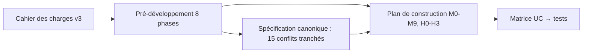

# LT-01 · Cadrage et pré-développement

## Résumé
Le cahier des charges DSFAV a été transformé en un dossier de pré-développement en 8 phases (charte, besoins, architecture, UX, données et API, sécurité, plan d'exécution, validation). Une relecture croisée a mis en évidence **15 contradictions** entre documents, chacune tranchée dans une spécification canonique, et un plan de construction en **10 jalons logiciels (M0 à M9) et 4 jalons matériels (H0 à H3)** a été établi (`pre-dev/09-canonical-spec.md` §1, `pre-dev/10-build-plan.md` §2-3).

## 1. Contexte et problématique
Les FAV présentent environ **23 % d'échec primaire** et **60 % de perméabilité à un an** (`pre-dev/00-project-charter.md` §1). La surveillance de routine repose sur la palpation, subjective ; l'écho-Doppler, référence, est trop coûteux pour être répété à chaque séance (3 fois par semaine). Le besoin : une mesure **objective, rapide (20 à 30 s), non invasive et peu coûteuse**, comparée à la référence personnelle du patient.

## 2. Objectifs
- Standardiser l'acquisition en 20 à 30 s par patient (FP1).
- Coût matériel du prototype 900 à 1 500 MAD, coût amorti 0,50 à 1,00 MAD par mesure (FC2).
- Autonomie d'au moins 20 mesures par jour (FC3).
- Banc d'essai pédagogique pour les internes (FP4).
Source : `pre-dev/00-project-charter.md` §2.

## 3. Démarche et méthode
Le document source unifié mélangeait trois natures de contenu : documents de phase, prompts de design et extraits de code. Ils ont été séparés (`SOURCE-RECONCILIATION.md`) en `pre-dev/` (phases), `artifacts/` (design) et `artifacts/implementation-reference/` (code de référence, non destiné à la production). Les identifiants présents dans la source n'ont pas été recopiés.

## 4. Conception

## 5. Réalisation
- 8 phases documentées dans `pre-dev/` (état dans `pre-dev/PROGRESS.md`).
- Spécification canonique `pre-dev/09-canonical-spec.md` : zones de pression uniques (< 2,5 / 2,5-3,0 / 3,0-8,5 / 8,5-9,0 / > 9,0 kPa), une seule mention légale, cycle de vie de la baseline (verrouillée après 3 mesures valides), score d'écart en z-score diagonal, rôles et permissions.
- Plan `pre-dev/10-build-plan.md` : jalons, tests « golden » G1 à G9 pour le traitement du signal, **15 défauts** relevés dans le code de référence (§7).

## 6. Vérification et résultats
| Élément | Résultat | Source |
|---|---|---|
| Phases complètes | 0, 2, 3, 4, 5, 7 complètes ; 1 partielle ; 6 et 8 en brouillon | `pre-dev/PROGRESS.md` |
| Conflits identifiés et tranchés | 15 | `09-canonical-spec.md` §1 |
| Décisions ouvertes pour le superviseur | 7 | `09-canonical-spec.md` §13 |

## 7. Décisions et justifications
- **Baseline sur 3 mesures** plutôt que « première mesure » : une seule mesure ne donne pas d'écart-type (ADR-003, canonique §4).
- **Seuil d'écart par défaut 3,4** au lieu de 2,5 : avec 3 caractéristiques, 2,5 déclencherait environ 10 % de fausses alertes sur des séances normales (loi du khi-deux à 3 degrés de liberté) ; 3,4 vise environ 1 % (canonique §4).

## 8. Limites et points ouverts
Étude de marché et analyse concurrentielle non étayées (phase 1 partielle). Les valeurs « à définir » du cahier (seuil, tolérance inter-appareils, temps de recharge) sont des valeurs par défaut à calibrer au banc (M9), pas des faits cliniques.

## 9. Ce qu'il faut retenir
- Le projet a une source de vérité unique pour chaque règle : la spécification canonique.
- Chaque cas d'utilisation sera prouvé par un test nommé.
- DSFAV ne pose jamais de diagnostic.

## 10. Questions possibles du jury
- **Pourquoi comparer le patient à lui-même et non à une norme ?** Les FAV diffèrent beaucoup entre patients ; une dérive personnelle est plus informative qu'un seuil de population (ADR-003).
- **Pourquoi 3 mesures pour la baseline ?** Minimum pour estimer une moyenne et une dispersion ; un plancher de 5 % de la moyenne évite qu'une baseline trop stable gonfle le score (canonique §4).
- **Que se passe-t-il si les documents se contredisent ?** La spécification canonique tranche ; le cahier reste l'autorité (AGENTS.md §2).

## Références
`DSFAV_cahier_des_charges_FINAL_v3.pdf` · `pre-dev/00-project-charter.md` · `pre-dev/09-canonical-spec.md` · `pre-dev/10-build-plan.md` · `pre-dev/03-ADRs/`
