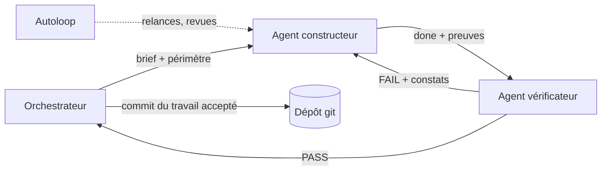

# LT-02 · Environnement d'ingénierie multi-agents

## Résumé
Nous avons installé un environnement où une session d'IA principale (l'orchestrateur) planifie le travail, le confie à des agents exécutants, fait relire chaque résultat par un agent vérificateur et n'intègre que le travail accepté. Le kit a passé **10 auto-tests sur 11**, **7 exécutants sur 10** ont répondu au test de disponibilité, et les règles propres à DSFAV ont été formalisées en **6 compétences** et **3 agents** (sources en §6).

## 1. Contexte et problématique
Un projet qui couvre firmware, traitement du signal, backend et interface demande beaucoup de travail répétitif mais exigeant en rigueur clinique. Confier ce travail à des agents d'IA n'est utile que si chaque contribution est **cadrée** (périmètre de fichiers), **vérifiée** (tests et règles) et **tracée** (journal).

## 2. Objectifs
- Un hub de coordination fonctionnel dans le dépôt (critère : `hub.mjs status` répond).
- Au moins 2 exécutants disponibles (critère : `dispatch.mjs ping all`).
- Des règles cliniques non négociables lisibles par tout agent avant tout travail.

## 3. Démarche et méthode
1. Installation du kit `agent-hub-orchestrator` v2.2.0 avec sauvegarde de l'ancienne copie, puis auto-test.
2. Initialisation du hub dans le dépôt (`.agent-hub/`) avec le pack « generic » : le pack « ui-migration » vise la copie de sites web et ne convient pas à un dispositif médical (décision D-004).
3. Test de disponibilité de chaque exécutant **avant** toute planification (règle du kit : ne jamais confier une tâche à un exécutant non testé).
4. Rédaction des règles DSFAV, des compétences et des agents.

## 4. Conception

Chaque agent lit d'abord `AGENTS.md` (règles), puis son brief, puis la compétence de son domaine. Le vérificateur est en lecture seule et applique une « règle d'arrêt » : après un premier tour de reprise, seul un défaut fonctionnel, clinique, d'accessibilité ou visuel majeur peut faire échouer une tâche.

## 5. Réalisation
- Règles : `AGENTS.md` §4 (10 règles cliniques : mention légale unique, aucune donnée nominative, zones de pression, porte qualité, baseline, seuils configurables, statuts, aucune perte de session, règle du banc, aucune conclusion clinique sur données synthétiques) et §5 (8 règles d'ingénierie).
- Compétences : `.claude/skills/dsfav-context` (domaine et chiffres canoniques), `dsfav-tdd`, `dsfav-dsp`, `dsfav-backend`, `dsfav-web`, `dsfav-academic`.
- Agents : `.claude/agents/dsfav-builder.md`, `dsfav-verifier.md`, `dsfav-dsp-tester.md`.
- Portes qualité : `docs/GATES.md` (G1 types, G2 lint, G3 tests écrits d'abord, G4 règles cliniques, G5 contrat, G6 secrets, G7 périmètre).
- Mémoire du projet : `docs/DECISIONS.md`, `docs/BACKLOG.md`, `docs/ARCHITECTURE.md`.

## 6. Vérification et résultats
| Vérification | Résultat | Source |
|---|---|---|
| Auto-test du kit | 10 PASS, 1 FAIL (`keeper.mjs --help` lance le service au lieu d'afficher l'aide) | sortie de `engine/selftest.mjs`, 2026-11-07 |
| Exécutants disponibles | 7/10 : Claude Sonnet 4.6, Gemini 3.8 Flash (×2), GLM, DeepSeek flash, GPT-6 (codex), Grok 4.7 (cursor) | `dispatch.mjs ping all` |
| Exécutants indisponibles | 3 (claude-ds1/2/3, crédit DeepSeek épuisé) | idem |
| Compétences DSFAV indexées | 5 au premier index, 6 avec `dsfav-academic` | `tools/skills.mjs build` |

## 7. Décisions et justifications
D-004 (pack générique et compétences propres au projet). Python est appelé via `uv` car la commande `python` du poste pointe vers un alias du Microsoft Store (D-002).

## 8. Limites et points ouverts
Le défaut `keeper.mjs --help` est à corriger dans le kit maître (hors périmètre du projet). Aucune tâche n'a encore suivi le cycle complet construction → revue → acceptation → commit par le hub : ce sera la première tâche du jalon M1.

## 9. Ce qu'il faut retenir
- L'IA produit, mais un vérificateur indépendant et des tests décident.
- Les règles cliniques sont écrites une fois et lues par tous les agents.
- On ne planifie que sur des exécutants testés.

## 10. Questions possibles du jury
- **Comment garantir que l'IA ne viole pas une règle clinique ?** Règles explicites (AGENTS.md §4), contrôles automatiques (GATES G4), agent vérificateur séparé du constructeur.
- **Pourquoi plusieurs modèles d'IA ?** Disponibilité et coût : si un fournisseur est saturé, la tâche passe au suivant ; la revue par un modèle différent réduit les biais communs.
- **Qui est responsable du code final ?** L'orchestrateur n'intègre que le travail accepté ; l'équipe humaine valide les jalons.

## Références
`AGENTS.md` · `docs/GATES.md` · `docs/DECISIONS.md` · `.claude/skills/` · `.claude/agents/` · `.agent-hub/PROTOCOL.md`
