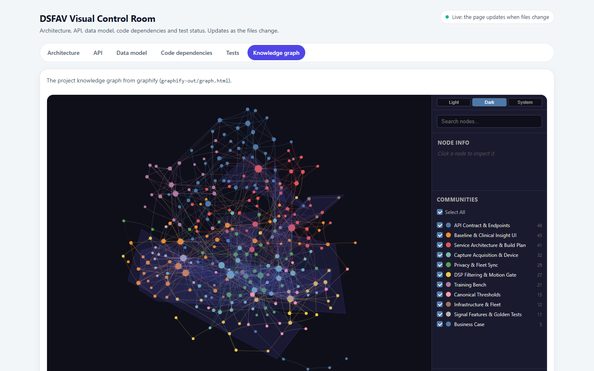

# LT-03 · Cartographie des connaissances du projet

## Résumé
Les 46 documents du projet (cahier des charges, dossier de pré-développement, design, contrat d'API) ont été convertis en un **graphe de connaissances de 284 concepts et 739 relations**, regroupés automatiquement en **11 communautés** thématiques. Le graphe sert de carte navigable du projet et révèle les concepts « ponts » et les zones faiblement documentées (`graphify-out/GRAPH_REPORT.md`).

## 1. Contexte et problématique
Le projet compte plus de 17 000 mots de spécification répartis en dizaines de fichiers. Il est difficile de voir quels documents parlent du même concept (par exemple UC7, la baseline) et où se trouvent les incohérences.

## 2. Objectifs
Obtenir une représentation visuelle et interrogeable des relations entre exigences, cas d'utilisation, composants et décisions, avec une traçabilité honnête de chaque relation (trouvée dans le texte ou déduite).

## 3. Démarche et méthode
Outil : graphify. Les fichiers techniques du kit et le document source brut ont été exclus (`.graphifyignore`, D-005) pour ne garder que le contenu DSFAV.
1. Détection : 46 fichiers, environ 23 300 mots (1 code, 44 documents, 1 PDF).
2. Extraction sémantique en parallèle par 3 agents légers (Claude Haiku), un par tiers du corpus ; extraction structurelle (AST) du contrat OpenAPI.
3. Fusion : les concepts partagés (UC1 à UC13, FP, FC, services) portent le même identifiant dans tous les lots, ce qui relie les documents entre eux (63 fusions).
4. Détection de communautés (algorithme de Louvain), nommage, rapport et page interactive.

Chaque relation est étiquetée **EXTRACTED** (explicite dans le texte), **INFERRED** (déduite, avec un score de confiance) ou **AMBIGUOUS** (incertaine, à vérifier).

## 4. Conception

## 5. Réalisation
- `graphify-out/graph.html` : graphe interactif (recherche, filtres par communauté).
- `graphify-out/GRAPH_REPORT.md` : rapport (concepts centraux, connexions surprenantes, questions suggérées).
- `graphify-out/graph.json` : données réutilisables.
- Le graphe est aussi intégré à la salle de contrôle visuelle (LT-06, onglet « Knowledge graph »).

## 6. Vérification et résultats
| Mesure | Valeur | Source |
|---|---|---|
| Concepts / relations / communautés | 284 / 739 / 11 | sortie de la construction du graphe, 2026-11-07 |
| Concept le plus connecté | UC1 Acquisition du thrill (26 relations) | `GRAPH_REPORT.md`, God Nodes |
| Suivants | API NestJS (25), unité ESP32-C3 (23), UC4, UC6, UC9 (21 chacun) | idem |
| Cycles d'import | aucun | idem |
| Coût d'extraction | 484 217 jetons d'entrée (3 agents) | rapports d'usage des agents |

Communautés : Contrat d'API · Baseline et interface clinique · Architecture et plan · Acquisition et appareil · Confidentialité et synchronisation · Filtrage et porte mouvement · Banc d'essai · Seuils canoniques · Infrastructure · Caractéristiques du signal et tests golden · Business case.

## 7. Décisions et justifications
D-005 : exclusion du kit et de la source brute, sinon le graphe aurait été dominé par l'outillage et par des doublons.

## 8. Limites et points ouverts
Les relations INFERRED et AMBIGUOUS sont produites par un modèle et doivent être vérifiées avant toute décision. Le rapport signale **17 nœuds faiblement connectés**, dont les rôles Infirmier, Interne et Administrateur : le tableau des rôles (canonique §10) devrait être relié plus explicitement aux cas d'utilisation. Le graphe se met à jour automatiquement pour le code (crochet git) ; les documents demandent une mise à jour manuelle (`/graphify . --update`).

## 9. Ce qu'il faut retenir
- UC1 est le pont entre presque toutes les parties du projet : c'est le flux le plus critique.
- Chaque relation dit si elle est trouvée ou supposée.
- Le graphe montre aussi ce qui manque.

## 10. Questions possibles du jury
- **Le graphe peut-il inventer des liens ?** Il peut en déduire ; ils sont marqués INFERRED avec un score, jamais présentés comme des faits.
- **À quoi sert-il concrètement ?** Retrouver tous les documents touchés par un changement (par exemple modifier la porte de pression), et repérer les zones peu spécifiées.

## Références
`graphify-out/GRAPH_REPORT.md` · `.graphifyignore` · `docs/DECISIONS.md` D-005
