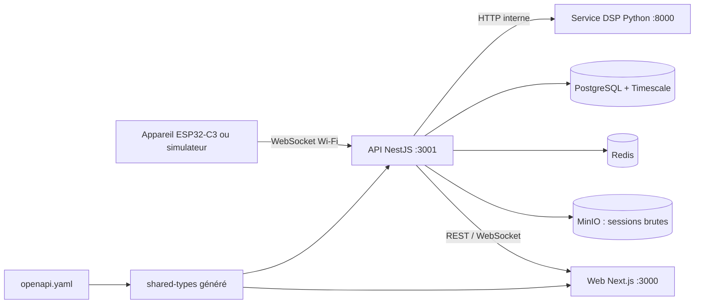
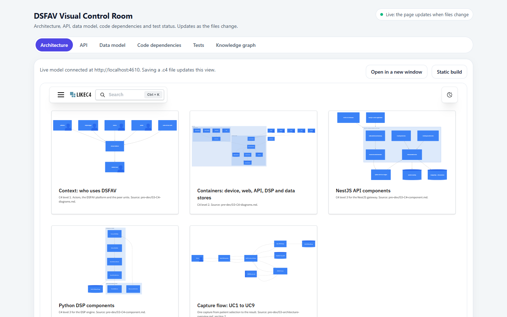

# LT-04 · Architecture et squelette logiciel (monorepo)

## Résumé
Le jalon M0 a produit le squelette exécutable de DSFAV : trois applications (interface web Next.js, API NestJS, service de traitement du signal Python), un paquet de types généré depuis le contrat d'API, la base de données décrite par Prisma, la composition Docker et l'intégration continue. **Vérification de types, analyse statique et tests passent pour les 8 paquets** ; l'interface web compile avec ses 9 écrans prévus (sorties des commandes du 2026-11-07, §6).

## 1. Contexte et problématique
Le plan impose « une tranche verticale à la fois » et « le contrat d'abord » (`pre-dev/10-build-plan.md` §1). Il faut donc un socle où chaque couche démarre, expose un point de santé et peut être testée, avant toute fonctionnalité clinique.

## 2. Objectifs
Critère du jalon M0 : un clone propre démarre la pile avec une commande et l'intégration continue est verte sur une suite de tests minimale (`10-build-plan.md` §3 M0).

## 3. Démarche et méthode
Le squelette a été généré par un agent exécutant (Claude Haiku) à partir d'un cahier précis (arborescence, ports, points de santé, tests, conteneurs), puis **vérifié indépendamment** par l'orchestrateur, qui a corrigé un écart (voir §7).

## 4. Conception

## 5. Réalisation
| Dossier | Rôle | Point de santé |
|---|---|---|
| `apps/web-nextjs` | 9 écrans : connexion, tableau de bord, acquisition, patients, dossier patient, banc, flotte, paramètres | `/api/health` |
| `apps/api-nestjs` | API, schéma Prisma (`prisma/schema.prisma`), modules prévus (auth, patients, mesures, baseline, appareils, banc, audit, configuration) | `/health` |
| `apps/dsp-python` | bibliothèque pure `dsfav_dsp` + enveloppe FastAPI | `/health` |
| `packages/shared-types` | types TypeScript générés depuis `pre-dev/05-api-contracts/openapi.yaml` | n/a |
| `e2e/` | tests de bout en bout Playwright | n/a |
| `firmware/`, `scripts/simulator/` | emplacements des jalons H1-H3 et M4 | n/a |
| `docker-compose.yml` (+ `.override.yml`) | 6 services avec contrôles de santé ; aucun port de base de données publié hors développement | n/a |
| `.github/workflows/ci.yml` | lint, types, tests, contrat, composition | n/a |

La mention légale est définie **une seule fois** (`apps/web-nextjs/src/libs/clinical/disclaimer.ts`) et importée par le composant d'affichage ; un test vérifie le texte exact.

## 6. Vérification et résultats
| Commande | Résultat | Source |
|---|---|---|
| `pnpm install` | 8 projets, à jour | sortie du 2026-11-07 |
| `pnpm -r typecheck` | PASS (code 0) | idem |
| `pnpm -r lint` | PASS (ESLint, oxlint, Ruff) | idem |
| `pnpm -r test` | API 2/2, web 1/1, DSP 1/1, e2e 1 ignoré (pas de serveur) | `reports/junit/*.xml` |
| `pnpm --filter @dsfav/web build` | PASS, routes générées | sortie du build |
| `prisma validate` | PASS après correction | sortie de Prisma 7.10.1 |
| Lint du contrat OpenAPI | 0 erreur, 5 avertissements | rapport de l'agent, `redocly lint` |
| `docker compose config` | PASS (images non construites) | rapport de l'agent |
| Contrôles G4 / G6 | aucune donnée nominative dans le schéma et le contrat ; aucun secret | grep du 2026-11-07 |

Versions : Next.js 16.4.5, React 19.3.0, NestJS 12.4.0, Prisma 7.10.1, FastAPI 0.162.1, NumPy 2.5.4, SciPy 1.18.1 (rapport de l'agent).

## 7. Décisions et justifications
- D-001 Next.js 16 au lieu de 15 ; D-002 Python 3.12 via `uv` ; D-003 chaque application garde son lanceur de tests natif, unifiés par des rapports JUnit.
- **Prisma 7** n'accepte plus l'URL de connexion dans le schéma ; elle a été déplacée dans `apps/api-nestjs/prisma.config.ts`. Le schéma reste la copie de référence du pré-développement, à amender au jalon M1.
- Prisma épinglé en 7.10.1 : l'étiquette « latest » du registre pointait vers une version candidate 8.0.

## 8. Limites et points ouverts
Les Dockerfiles ne sont pas encore construits ni testés. Le schéma Prisma n'intègre pas encore les ajouts de la spécification canonique (§6 : source de mesure, versions de baseline, audit, configuration versionnée) : c'est l'objet de M1. Les écrans ne contiennent qu'un titre et la mention légale.

## 9. Ce qu'il faut retenir
- Trois services séparés : interface, orchestration, calcul scientifique (ADR-001).
- Les types circulent dans un seul sens : contrat → types générés → applications.
- Un squelette vérifié vaut mieux que des fonctionnalités non testées.

## 10. Questions possibles du jury
- **Pourquoi Python pour le signal et non Node.js ?** NumPy et SciPy fournissent des filtres et transformées éprouvés ; NestJS orchestre l'authentification, la persistance et le temps réel (ADR-001).
- **Pourquoi un monorepo ?** Un seul contrat d'API partagé, une seule intégration continue, des changements atomiques entre API et interface.
- **Comment éviter d'exposer la base de données ?** Le fichier de composition de base ne publie aucun port de base ; seul le fichier de développement le fait.

## Références
`pre-dev/07-execution-blueprint.md` · `pre-dev/03-ADRs/ADR-001-*.md` · `docs/ARCHITECTURE.md` · `docs/DECISIONS.md`
