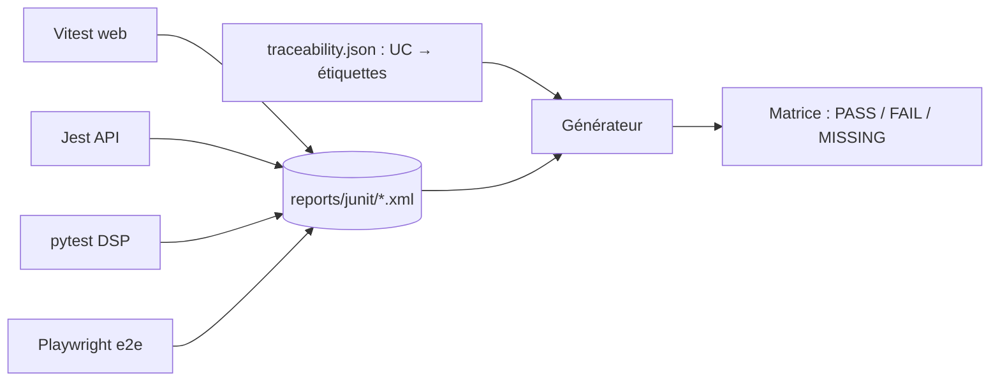
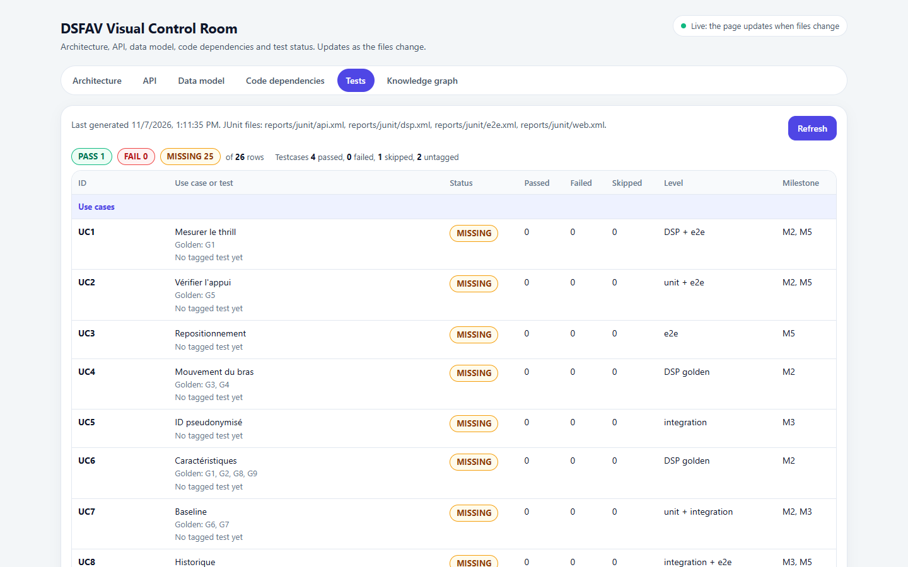

# LT-05 · Développement piloté par les tests et traçabilité

## Résumé
Nous avons mis en place un cadre où chaque cas d'utilisation du cahier des charges est relié à un test nommé, et où l'état de ces tests est visible dans une matrice de traçabilité qui se met à jour automatiquement. La matrice compte **26 lignes** (13 cas d'utilisation, 9 tests golden du signal, 4 propriétés transverses) ; à ce jour **1 est prouvée (mention légale), 0 en échec, 25 à écrire** (`docs/visual/traceability.json`, 2026-11-07).

## 1. Contexte et problématique
Dans un dispositif d'aide à la décision médicale, « l'écran existe » ne prouve rien. Le plan pose la règle : **un cas d'utilisation est terminé quand son test passe dans l'intégration continue** (`pre-dev/10-build-plan.md` §1.5).

## 2. Objectifs
- Une convention unique pour relier un test à une exigence.
- Une vue d'ensemble lisible sans lire le code.

## 3. Démarche et méthode
Cycle **rouge → vert → refactorisation** : écrire le test qui échoue pour la bonne raison, écrire le minimum qui le fait passer, nettoyer sans changer le comportement (`.claude/skills/dsfav-tdd/SKILL.md`).

Convention d'étiquettes dans le nom des tests : `[UC1]`…`[UC13]`, `[G1]`…`[G9]`, `[DISCLAIMER]`, `[NO-LOSS]`, `[PSEUDO-SCAN]`, `[AUTHZ-MATRIX]`. Exemple réel : `[DISCLAIMER] renders the exact clinical disclaimer` (`apps/web-nextjs/src/components/shared/disclaimer.test.tsx`).

Chaque lanceur écrit un rapport JUnit dans `reports/junit/` ; un générateur lit ces rapports et calcule l'état de chaque ligne.

## 4. Conception

## 5. Réalisation
- Lanceurs : Vitest (web), Jest (API), pytest + Hypothesis (DSP), Playwright (bout en bout).
- Matrice source : `tools/visual/traceability.json` (reprend `10-build-plan.md` §4).
- Générateur : `tools/visual/gen/traceability.mjs`.
- Tests golden du signal (G1 à G9) spécifiés avec leurs tolérances, et un générateur de signaux synthétiques dont les caractéristiques sont connues à l'avance (`10-build-plan.md` §5) ; ils seront écrits **avant** le pipeline par l'agent `dsfav-dsp-tester`.

## 6. Vérification et résultats
| Ligne | État | Source |
|---|---|---|
| DISCLAIMER | PASS | `reports/junit/web.xml` |
| HEALTH (API, DSP) | PASS | `reports/junit/api.xml`, `dsp.xml` |
| UC1 à UC13, G1 à G9, NO-LOSS, PSEUDO-SCAN, AUTHZ-MATRIX | MISSING (attendu au jalon M0) | `docs/visual/traceability.json` |

## 7. Décisions et justifications
D-003 : chaque application garde son lanceur natif, et le format JUnit commun permet une vue unique.

## 8. Limites et points ouverts
La matrice prouve qu'un test existe et passe, pas qu'il est pertinent : la revue par l'agent vérificateur contrôle qu'il échouerait sans le changement. Les tests golden prouvent les mathématiques, pas la valeur clinique (AGENTS.md §4.10).

## 9. Ce qu'il faut retenir
- Une exigence sans test n'est pas terminée.
- Les limites sont testées des deux côtés et à l'égalité (G7 : l'égalité au seuil n'est pas une alerte).
- La matrice rend l'avancement visible pour un non-développeur.

## 10. Questions possibles du jury
- **Pourquoi des signaux synthétiques ?** On connaît la réponse attendue (RMS, rapport, fréquence), donc on peut vérifier le calcul exactement ; aucune donnée patient dans le dépôt.
- **Comment savoir que l'application ne perd aucune mesure ?** Test de propriété « no-loss » : avec coupures et doublons aléatoires, le nombre de sessions stockées égale le nombre de captures acceptées (`10-build-plan.md` §4).

## Références
`pre-dev/10-build-plan.md` §4-5 · `.claude/skills/dsfav-tdd/SKILL.md` · `tools/visual/traceability.json`
