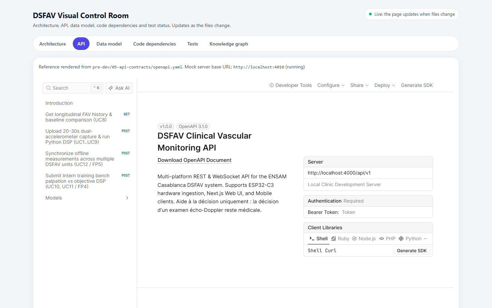
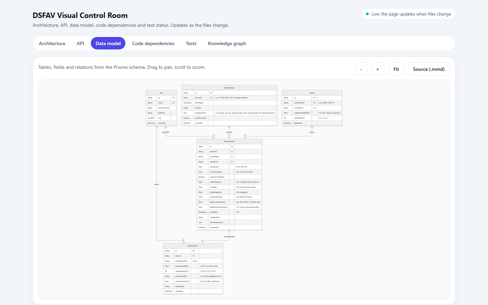
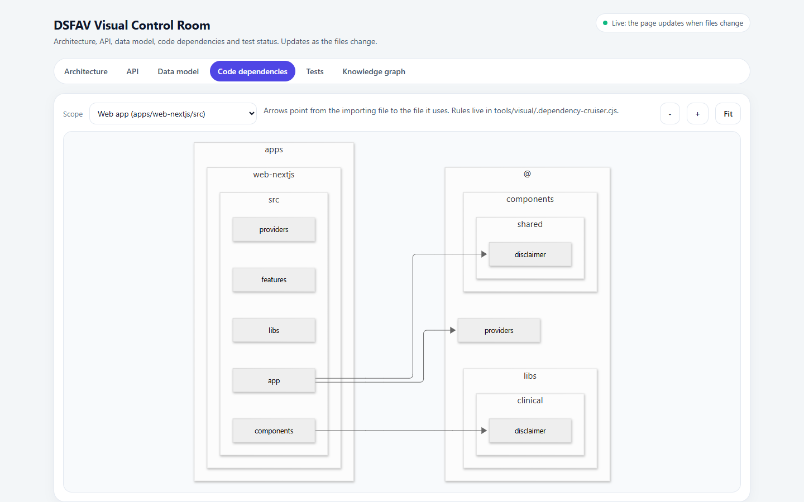

# LT-06 · Salle de contrôle visuelle

## Résumé
Une application locale réunit en six onglets les vues du projet : architecture C4 vivante, référence de l'API, modèle de données, dépendances du code, matrice des tests et graphe de connaissances. Elle se met à jour quand les fichiers changent. Les six onglets s'affichent **sans erreur de console** dans un navigateur réel (vérification Playwright/Edge du 2026-11-07).

## 1. Contexte et problématique
Le porteur du projet doit piloter et présenter le système sans lire le code. Les diagrammes dessinés à la main se périment dès que le code évolue.

## 2. Objectifs
Des vues **générées depuis les sources** (modèle C4, contrat d'API, schéma de base, imports du code, rapports de tests), toujours à jour, accessibles par une commande : `pnpm visual`.

## 3. Démarche et méthode
Chaque vue est produite par un outil qui lit une source unique :

| Onglet | Source | Outil |
|---|---|---|
| Architecture | `architecture/*.c4` | LikeC4 (serveur vivant, port 4610) |
| API | `pre-dev/05-api-contracts/openapi.yaml` | Scalar (rendu), Prism (serveur simulé, port 4010) |
| Modèle de données | `apps/api-nestjs/prisma/schema.prisma` | générateur Mermaid `gen/erd.mjs` |
| Dépendances | imports du code | dependency-cruiser, avec règles (pas de cycle, pas d'import web ↔ API) |
| Tests | `reports/junit/*.xml` | `gen/traceability.mjs` (LT-05) |
| Graphe | `graphify-out/graph.html` | graphify (LT-03) |

Le serveur (port 4600) surveille les dossiers sources et relance le générateur concerné, puis notifie la page.

## 4. Conception

## 5. Réalisation
`tools/visual/` (serveur, générateurs, page), `architecture/` (modèle C4 : 5 vues, du contexte au flux de capture UC1 à UC9), `.vscode/` (12 extensions recommandées, tâches « Visual: control room » et « Tests: all »), guide `docs/visual/README.md`.

## 6. Vérification et résultats
| Vérification | Résultat | Source |
|---|---|---|
| Validation et build du modèle C4 | PASS | rapport de l'agent, `likec4 validate` / `build` |
| Modèle de données généré | 5 modèles, 3 énumérations, 5 relations | sortie de `gen/erd.mjs` |
| Six onglets dans Edge | 0 erreur de console | script Playwright, 2026-11-07 |
| Onglet Architecture | défaut trouvé puis corrigé (voir §7) | captures avant/après |

## 7. Décisions et justifications
**Défaut corrigé :** l'onglet Architecture annonçait « serveur non démarré » alors qu'il répondait. Cause : LikeC4 écoute sur l'adresse IPv6 `::1`, et la sonde interrogeait `127.0.0.1` (IPv4). Correction : sonder `localhost` (`tools/visual/server.mjs:85`). Ce piège figure dans les leçons du kit.
Bibliothèques chargées depuis un CDN épinglées à des versions précises de plus de deux semaines (Mermaid 12.2.0, Scalar 1.76.0) pour la reproductibilité.

## 8. Limites et points ouverts
Le serveur simulé Prism ne recharge pas le contrat à chaud (redémarrer `pnpm visual:mock`) et met environ une minute à démarrer sur ce poste. Les liens du modèle C4 vers les documents fonctionnent dans l'aperçu vivant, pas dans la version statique.

## 9. Ce qu'il faut retenir
- Chaque diagramme est calculé depuis le code ou la spécification : il ne peut pas mentir longtemps.
- Une seule commande ouvre toute la vue d'ensemble.

## 10. Questions possibles du jury
- **Qu'est-ce que le modèle C4 ?** Quatre niveaux de zoom : qui utilise le système, quels conteneurs, quels composants, quel code ; nous utilisons les trois premiers.
- **À quoi sert le serveur simulé ?** L'interface peut être développée et démontrée contre l'API avant que le backend existe (« contrat d'abord »).

## Références
`docs/visual/README.md` · `tools/visual/` · `architecture/`
