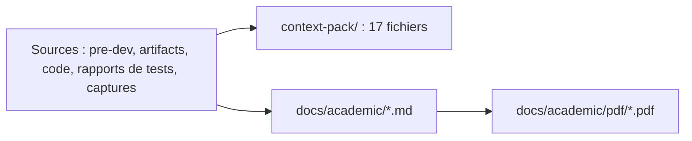

# LT-08 · Pack de contexte et documentation académique

## Résumé
Deux mécanismes de documentation ont été mis en place. Le **pack de contexte** regroupe tout le projet en 17 fichiers (environ 1,1 Mo) pour l'importer dans un assistant externe. Le **dossier académique** (ce dossier) produit un rapport par lot de travail, rendu en PDF au format A4. Les deux se régénèrent par une commande (`pnpm context-pack`, `pnpm academic`).

## 1. Contexte et problématique
Le projet doit pouvoir être expliqué à un enseignant, repris par un autre membre de l'équipe, et compris par un assistant d'IA externe, sans relire la conversation de travail.

## 2. Objectifs
- Un ensemble de fichiers autosuffisant et à jour, avec un ordre d'autorité explicite.
- Un rapport académique par étape, dont chaque chiffre cite sa source.

## 3. Démarche et méthode
- **Pack de contexte** (`tools/context-pack/build.mjs`) : concatène les documents par thème avec, avant chaque extrait, le chemin du fichier source ; ajoute l'arborescence du dépôt, les configurations, un instantané du code et des instructions prêtes à coller. Les assistants limitent le nombre de fichiers, d'où le regroupement.
- **Dossier académique** : combine la logique « tuteur » du kit (expliquer simplement, citer le code réel, vérifier la compréhension) et la règle des rapports de session du kit (chaque chiffre cite sa source, aucun résultat inventé) ; structure imposée par `.claude/skills/dsfav-academic/SKILL.md`.

## 4. Conception

## 5. Réalisation
- `context-pack/00-README-START-HERE.md` (présentation, ordre d'autorité, instructions) à `16-source-code-snapshot.md`, plus le cahier des charges en PDF.
- `docs/academic/` : sommaire, glossaire et lots LT-01 à LT-08 ; rendu PDF par `tools/academic/build.mjs` (navigateur Edge sans interface, diagrammes Mermaid rendus).
- Le tuteur du projet (`.agent-hub/tutor/TUTOR.md`) dispose d'un mode « soutenance » qui interroge l'étudiant à partir des questions de chaque lot.

## 6. Vérification et résultats
| Vérification | Résultat | Source |
|---|---|---|
| Pack de contexte | 17 fichiers, environ 1 100 Ko | sortie de `build.mjs` |
| Secrets dans le pack | aucun ; le document source brut, qui contient un identifiant Wi-Fi, est exclu du pack et ignoré par git | recherche du 2026-11-07, `.gitignore` |

## 7. Décisions et justifications
Le dossier est rédigé en français, comme le cahier des charges et l'interface (`.agent-hub/tutor/TUTOR.md` §9).

## 8. Limites et points ouverts
Le pack et le dossier sont des instantanés : ils doivent être régénérés après chaque jalon. Les rapports rédigés par une IA doivent être relus par l'équipe avant présentation.

## 9. Ce qu'il faut retenir
- Documenter, c'est rendre le projet transmissible.
- Un chiffre sans source n'entre pas dans le dossier.

## 10. Questions possibles du jury
- **Comment savez-vous que ces rapports sont exacts ?** Chaque valeur renvoie à un fichier ou à une commande que l'on peut relancer.
- **Ces documents seront-ils tenus à jour ?** Un rapport par jalon, produit à la clôture du jalon, régénération par une commande.

## Références
`tools/context-pack/build.mjs` · `.claude/skills/dsfav-academic/SKILL.md` · `.agent-hub/tutor/TUTOR.md`
