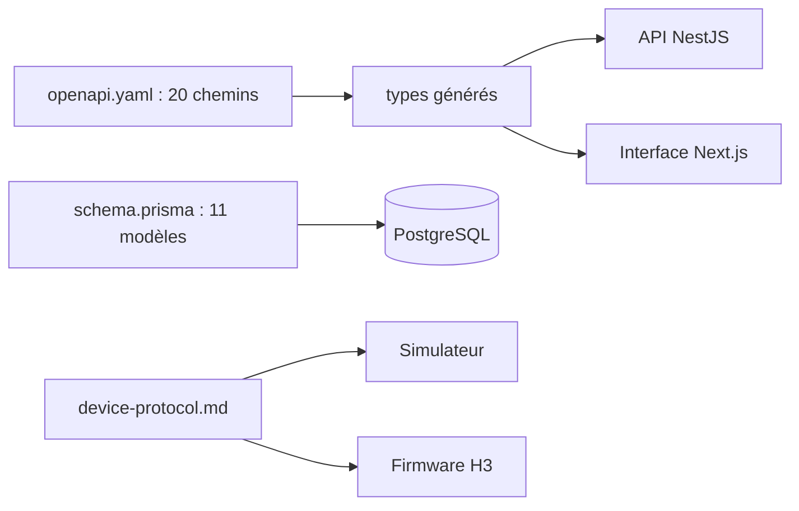

# LT-09 · Contrat d'API et modèle de données (jalon M1)

## Résumé
Le jalon M1 « gel du contrat » a fixé, avant tout code de fonctionnalité, les trois interfaces dont dépendent toutes les équipes : l'API publique (**20 chemins, 22 opérations**, OpenAPI 3.1 valide), la base de données (**11 modèles, 8 énumérations**, une migration appliquée et un jeu de données de démonstration) et le protocole de communication de l'appareil (document de 198 lignes). Le contrat a été validé par l'outil Redocly et un test automatique vérifie qu'aucun champ nominatif n'existe (sources en §6).

## 1. Contexte et problématique
Le plan impose « le contrat d'abord » (`pre-dev/10-build-plan.md` §1) : plusieurs agents construisent en parallèle l'API, l'interface et le simulateur. Sans interface figée, chacun devine les formes de données des autres et l'intégration échoue.

## 2. Objectifs
- Un contrat d'API unique, valide et suffisant pour les écrans (critère : validation sans erreur).
- Un schéma de base conforme à la spécification canonique §6 et **sans donnée personnelle** (règle FC1).
- Un protocole appareil ↔ serveur lisible par l'équipe matérielle (tâche H3).

## 3. Démarche et méthode
La tâche T-s01 a été confiée à un agent exécutant, puis relue par un agent indépendant (3 tours). Le contrat OpenAPI est la source ; les types TypeScript de l'interface sont **générés** depuis lui (`packages/shared-types`), jamais écrits à la main.

## 4. Conception

Modèles : User, PatientPseudo, Device, BaselineVersion, ConfigVersion, Measurement, ClinicalNote, FollowUpIntent, AuditEvent, SyncQueueItem, BenchSession. Énumérations : UserRole, FistulaType, AlertStatus, RejectReason, PerceivedThrill, MeasurementSource, SyncState, ConfigStatus.

## 5. Réalisation
- `pre-dev/05-api-contracts/openapi.yaml` : routes de la spécification canonique §7 (authentification, mesures en deux étapes, patients, appareils, banc, configuration), corps d'erreur unique `{code, message_fr, retryable, field?}`, champ `disclaimer` sur toute réponse portant une mesure.
- `apps/api-nestjs/prisma/schema.prisma` et la migration `20261107141111_v1` ; `prisma/seed.ts` crée 4 utilisateurs (un par rôle), 2 patients pseudonymisés, 4 appareils, une configuration active et une baseline verrouillée.
- `docs/protocol/device-protocol.md` : trames WebSocket de l'appareil et format binaire de l'envoi brut (en-tête, échantillons entiers 16 bits, pression en centi-kPa).
- `apps/api-nestjs/test/pseudo-scan.spec.ts` : lit le schéma Prisma et le contrat et **échoue** si un champ nominatif apparaît (nom, prénom, CIN, date de naissance, téléphone, adresse) ; des tests négatifs prouvent qu'il détecte `name` et `firstName`.

## 6. Vérification et résultats
| Vérification | Résultat | Source |
|---|---|---|
| Validation du contrat | valide (0 erreur) | `pnpm contract` (Redocly), 2026-11-07 |
| Chemins / opérations | 20 / 22 | comptage dans `openapi.yaml` |
| Modèles / énumérations | 11 / 8 | `schema.prisma` |
| Test PSEUDO-SCAN | 5 tests passent | `pnpm --filter @dsfav/api test` |
| Données de démonstration | 4 utilisateurs, 2 patients, 4 appareils, 1 configuration, 1 baseline | requête sur la base, 2026-11-07 |
| Client Prisma réel | lecture réussie via l'adaptateur `pg` | script de vérification, 2026-11-07 |

## 7. Décisions et justifications
- **Prisma 7 exige un adaptateur de pilote** pour joindre PostgreSQL ; il n'était pas installé et un agent avait contourné le problème par une base simulée en mémoire. L'orchestrateur a installé `@prisma/adapter-pg` et `pg`, vérifié la lecture réelle, puis renvoyé la tâche en reprise (voir LT-02 pour le processus de revue).
- **Contrat avant code** : les écrans ont découvert deux manques que le gel n'avait pas prévus (aucune route de lecture des notes ; aucune donnée de synchronisation dans la synthèse d'appareil). Ils sont consignés dans `docs/BACKLOG.md` plutôt que contournés dans l'interface.

## 8. Limites et points ouverts
Le contrat n'est pas encore implémenté par l'API : l'historique d'un patient renvoie pour l'instant des lignes brutes de base, alors que le contrat définit une autre forme ; la correction est confiée à la tâche T-s07. Le seuil d'alerte et le temps de recharge restent des valeurs par défaut « à calibrer au banc ».

## 9. Ce qu'il faut retenir
- Une interface figée en premier permet de construire en parallèle sans se marcher dessus.
- Un test automatique garantit l'absence de données personnelles, à chaque exécution.
- Un contrat peut être valide et pourtant incomplet : ce sont les écrans qui l'ont montré.

## 10. Questions possibles du jury
- **Pourquoi générer les types plutôt que les écrire ?** Le compilateur signale alors tout écart entre l'interface et l'API.
- **Comment garantir l'absence de données nominatives ?** Le test PSEUDO-SCAN échoue à la moindre apparition d'un champ de ce type, dans le schéma comme dans le contrat.
- **Pourquoi des données de démonstration dans la base ?** Pour que la démonstration et les tests partent d'un état connu ; les mots de passe de développement ne figurent que dans le jeu de données et le guide de démarrage.

## Références
`pre-dev/05-api-contracts/openapi.yaml` · `apps/api-nestjs/prisma/schema.prisma` · `docs/protocol/device-protocol.md` · `docs/DECISIONS.md` · `pre-dev/09-canonical-spec.md` §6-7
