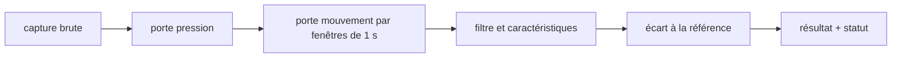

# LT-10 · Moteur de traitement du signal (jalon M2)

## Résumé
Le jalon M2 a produit le moteur qui transforme une capture brute (accéléromètre à 1 kHz, accéléromètre de mouvement à 200 Hz, pression) en un enregistrement contrôlé : porte de pression, porte qualité, caractéristiques du signal et écart à la référence personnelle du patient. Le moteur est une bibliothèque Python pure (`dsfav_dsp`, environ 800 lignes) exposée par une petite API. Ses **25 tests passent** (9 tests « golden » G1 à G9, tests de propriétés, test de performance, tests de l'API), le traitement de 25 s de signal prend **0,08 s** pour un budget de 1,5 s (sources en §6).

## 1. Contexte et problématique
La décision d'une mesure repose sur des règles chiffrées : pression valide de 3,0 à 8,5 kPa, mouvement rejeté au-delà de 0,08 g RMS par fenêtre d'une seconde, rejet sous 12 s de signal propre. Ces règles doivent être vérifiables sans matériel : le dispositif n'existe pas encore, donc le moteur est testé sur des signaux synthétiques dont on connaît la bonne réponse.

## 2. Objectifs
- Appliquer les règles de la spécification canonique à l'identique, avec des seuils lus dans la configuration et non écrits dans le code.
- Prouver le calcul (RMS, fréquence dominante, rapport hautes/basses fréquences) par des tests dont la réponse est connue d'avance.
- Rester sous 1,5 s par séance pour que l'API puisse l'appeler en synchrone.

## 3. Démarche et méthode
Les tests ont été écrits **avant** le code (rouge puis vert). Un générateur de signaux synthétiques (`synth.py`) crée des cas contrôlés : signal propre, rafale de mouvement, pression instable. Les tests G1 à G9 fixent le comportement attendu ; les tests de propriétés vérifient des invariants sur des entrées aléatoires.

## 4. Conception

Modules : `gate.py` (pression et qualité), `filters.py`, `features.py`, `baseline.py` (référence personnelle), `pipeline.py` (enchaînement), `api.py` (exposition).

## 5. Réalisation
- **Gravité retirée axe par axe** : l'accéléromètre de mouvement mesure aussi la pesanteur (1 g). La médiane de chaque axe est retranchée avant le calcul du RMS. Une première idée (médiane de la norme) échouait sur les longues rafales ; elle a été abandonnée après le test G4.
- **Fenêtres alignées de 1 s, sans recouvrement** (décision D-011) : une rafale de 2 s masque exactement 2 secondes, ce qui rend le test G3 déterministe.
- **Gain** : le gain de calibration reste un multiplicateur ; l'API envoie l'inverse du gain de l'appareil, d'où un traitement identique d'un appareil à l'autre.
- Les erreurs d'entrée renvoient un message en français (`INVALID_REQUEST`).

## 6. Vérification et résultats
| Vérification | Résultat | Source |
|---|---|---|
| Tests du moteur | 25 passent, 0 échec | `uv run pytest` dans `apps/dsp-python`, 2026-11-08 |
| Tests golden G1 à G9 | 9 définis, tous passent | `tests/golden/test_golden.py` |
| Performance | 0,08 s pour 25 s de signal (budget 1,5 s) | `tests/test_performance.py` |
| Revue indépendante | PASS (Gemini), 2 remarques non bloquantes | journal du hub, tâche T-s04 |

## 7. Décisions et justifications
- **Tests avant code** : sans signal réel, seul un signal fabriqué dont on connaît le résultat prouve que le calcul est juste.
- **Seuils en configuration** : ils sont marqués « à calibrer au banc » dans la spécification et doivent pouvoir changer sans modifier le code.
- **Une erreur d'orchestration corrigée** : une consigne de ma part (diviser par le gain) contredisait les tests ; elle a été retirée et le test fait foi.

## 8. Limites et points ouverts
Les tests G1 à G9 **prouvent le calcul, pas la médecine** : les signaux sont synthétiques. Aucune valeur clinique ne peut être déduite avant l'étude sur banc (jalon M9). Remarque ouverte de la revue : la durée en échantillons de pression utilise une division entière ; un arrondi serait plus fidèle sur les limites d'une seconde.

## 9. Ce qu'il faut retenir
- Un moteur de calcul se prouve avec des signaux dont on connaît la réponse.
- Les seuils cliniques sont de la configuration, pas du code.
- Un test qui contredit la consigne du chef de projet doit être écouté, pas contourné.

## 10. Questions possibles du jury
- **Pourquoi des signaux synthétiques ?** Le dispositif n'existe pas encore ; le synthétique fournit une réponse connue pour vérifier le calcul.
- **Cela prouve-t-il que l'outil détecte une sténose ?** Non. Cela prouve que le calcul est exact ; la validité clinique relève de l'étude sur banc.
- **Pourquoi retirer la gravité axe par axe ?** La pesanteur s'ajoute à chaque axe ; la médiane de chaque axe l'estime sans être gênée par une rafale courte.

## Références
`apps/dsp-python/src/dsfav_dsp/` · `apps/dsp-python/tests/` · `docs/DECISIONS.md` (D-011 à ajouter) · `pre-dev/09-canonical-spec.md`
