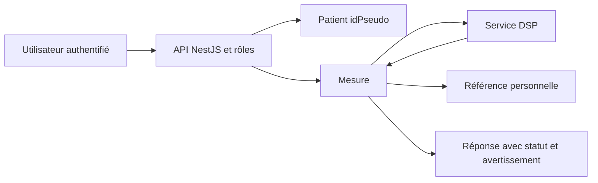

# LT-11 · Cœur backend et pipeline de mesure

## Résumé
Le backend relie l’authentification, les patients pseudonymisés, les mesures, la référence personnelle et le service DSP. Les modules NestJS sont enregistrés dans l’application et les tests couvrent les rôles, la sérialisation, la référence et la persistance. La validation d’intégration reste partielle : plusieurs preuves API n’ont pas démarré à cause de la résolution locale de `@prisma/adapter-pg` (journal du hub, T-s05, T-s07, T-s11, T-s12, T-s19).

## 1. Contexte et problématique
Le système doit conserver chaque tentative de mesure et fournir une réponse structurée, avec un statut et les éléments nécessaires à l’interprétation médicale. Le plan M3 relie l’authentification par rôles, les patients, le cycle de référence et le traitement DSP (pré-dev/10-build-plan.md, §3 M3).

## 2. Objectifs
- Enregistrer les mesures et leurs statuts, puis les comparer à la référence propre au patient (pré-dev/09-canonical-spec.md, §6; `apps/api-nestjs/src/modules/measurements/`).
- Contrôler l’accès selon la matrice des rôles, couverte par `[AUTHZ-MATRIX]` (journal du hub, T-s05; `apps/api-nestjs/test/authz-matrix.e2e-spec.ts`).
- Conserver l’avertissement clinique dans les réponses via la constante partagée du backend (`apps/api-nestjs/src/common/constants.ts:2-3`).

## 3. Démarche et méthode
Les travaux acceptés ont relié les modules réels et renforcé les tests ciblés. Le rapport distingue les tests exécutés et ceux empêchés avant leur démarrage, selon les preuves consignées par tâche (journal du hub, événements `done` de T-s05, T-s07, T-s19).

## 4. Conception

Le service de mesure appelle le client DSP, puis sérialise le résultat. Les routes de référence et d’audit restent dans des modules séparés (`apps/api-nestjs/src/modules/measurements/measurements.service.ts`; `apps/api-nestjs/src/modules/measurements/dsp.client.ts`; `apps/api-nestjs/src/modules/measurements/measurement.serializer.ts`).

## 5. Réalisation
Les tâches acceptées ont relié Prisma à la base existante, les modules métier et les protections d’accès (journal du hub, T-s05 et T-s19). Le pipeline de signal est une bibliothèque Python indépendante et un service FastAPI (`apps/dsp-python/src/dsfav_dsp/pipeline.py`; `apps/dsp-python/src/dsfav_dsp/api.py`). La référence est construite et verrouillée par la logique backend (`apps/api-nestjs/src/modules/baseline/baseline.logic.ts`).

## 6. Vérification et résultats
| Vérification | Résultat | Source |
|---|---|---|
| Matrice d’autorisations et tests API ciblés | 64 tests passent selon le compte rendu; la suite API du builder a réussi | journal du hub, T-s05, événement `done` |
| Pipeline DSP | 25 tests passent; test de performance mesuré sous la limite NFR-01 dans ce run | journal du hub, T-s04; `apps/dsp-python/tests/test_performance.py`; pré-dev/10-build-plan.md, §3 M2 |
| Intégration API indépendante | Non mesurée dans certains runs : Jest s’arrête avant les tests sur `@prisma/adapter-pg` | journal du hub, T-s07, T-s11, T-s12, T-s19 |
| Lint et types API | Typecheck sans erreur ; suite complète 117 tests passés, 0 échec, 8 ignorés (trois exécutions consécutives) | `pnpm --filter @dsfav/api test` et `tsc --noEmit`, 2026-11-08 |

Les résultats de tests prouvent le comportement logiciel dans les conditions du test, pas une performance ou une efficacité clinique.

## 7. Décisions et justifications
Le traitement DSP est synchrone dans le déploiement de démonstration; Redis, MinIO et les fonctionnalités Timescale ne sont pas utilisés dans la première version (docs/DECISIONS.md, D-007). Les seuils restent configurables et doivent être calibrés au banc (AGENTS.md, §4 règle 6; pré-dev/09-canonical-spec.md).

## 8. Limites et points ouverts
La résolution de `@prisma/adapter-pg` a empêché plusieurs suites d’intégration de démarrer; ces cas ne sont donc pas déclarés réussis (journal du hub, T-s07, T-s11, T-s12, T-s19). La cohérence clinique des seuils n’est pas démontrée par les fixtures synthétiques (pré-dev/10-build-plan.md, §1 principes 4 et 6).

## 9. Ce qu'il faut retenir
- Le backend enregistre des mesures sous identifiant pseudonyme.
- Le calcul de signal et la persistance sont des responsabilités distinctes.
- Un test qui n’a pas démarré ne constitue pas une preuve de réussite.
- Les essais synthétiques prouvent une partie du calcul, pas une décision médicale.

## 10. Questions possibles du jury
- **Pourquoi isoler le DSP ?** Pour tester le calcul sans dépendre de l’interface (`apps/dsp-python/src/dsfav_dsp/`).
- **La matrice des rôles est-elle vérifiée ?** Oui : la matrice AUTHZ-MATRIX est exécutée par la suite e2e de l’API (117 tests passés au total le 2026-11-08, `pnpm --filter @dsfav/api test`). Les blocages signalés pendant la construction venaient du bac à sable des agents, qui ne suit pas les liens pnpm, et non du code.
- **Les seuils sont-ils cliniquement validés ?** Non; ils doivent être calibrés au banc (AGENTS.md, §4 règle 6).

## Références
`apps/api-nestjs/src/modules/` · `apps/dsp-python/src/dsfav_dsp/` · `apps/api-nestjs/test/authz-matrix.e2e-spec.ts` · `.agent-hub/events.jsonl` (T-s04, T-s05, T-s07, T-s11, T-s12, T-s19) · `docs/DECISIONS.md` · `pre-dev/09-canonical-spec.md` · `pre-dev/10-build-plan.md`
