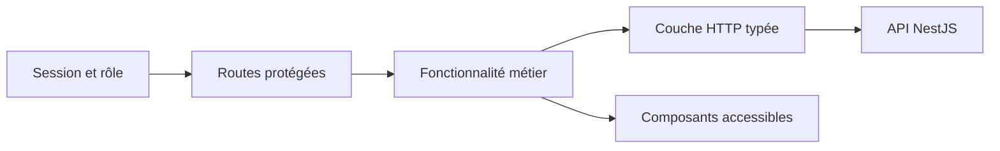

# LT-12 · Application web et système de design

## Résumé
L’application Next.js fournit les parcours de connexion, capture, revue patient, file de synchronisation et administration des appareils. Les vues utilisent des composants réutilisables et des contenus en français. Les dernières preuves enregistrées couvrent 16 fichiers de test et 98 tests web; des vérifications plus anciennes signalent des échecs transitoires dans les travaux d’autres voies (journal du hub, T-s17, T-s18, T-s20).

## 1. Contexte et problématique
L’infirmier capture la mesure sur tablette; le néphrologue consulte l’historique; l’interne utilise le banc de formation (AGENTS.md, §3). L’interface doit expliquer les états de qualité et ne pas afficher de valeurs objectives fictives en mode réel (`apps/web-nextjs/src/features/capture/`).

## 2. Objectifs
- Présenter les parcours principaux selon les rôles et les règles d’accès (pré-dev/09-canonical-spec.md, §10; `apps/web-nextjs/src/proxy.ts`).
- Afficher des données typées et des états d’attente ou d’indisponibilité (`apps/web-nextjs/src/features/`; journal du hub, T-s13 et T-s20).
- Garder les libellés cliniques en français et afficher l’avertissement partagé (`apps/web-nextjs/src/libs/clinical/disclaimer.ts`; AGENTS.md, §5 règle 8).

## 3. Démarche et méthode
Les changements ont été développés par fonctionnalité avec tests Vitest ciblés et vérification de types/lint. Le système de composants conserve l’accès clavier et les noms accessibles dans les contrôles concernés (journal du hub, T-s18; `apps/web-nextjs/src/components/`).

## 4. Conception

Les pages serveur chargent les données et délèguent les interactions locales aux composants client (`apps/web-nextjs/src/app/(clinic)/`; `apps/web-nextjs/src/features/`).

## 5. Réalisation
Les vues incluent notamment capture, patients, appareils, banc et historique de référence (`apps/web-nextjs/src/features/`). Les routes de chargement différé utilisent des frontières Suspense pour plusieurs écrans de clinique (`apps/web-nextjs/src/app/(clinic)/dashboard/page.tsx`; T-s20). Le proxy de session est dans `src/proxy.ts` après migration du middleware (journal du hub, T-s16).

## 6. Vérification et résultats
| Vérification | Résultat | Source |
|---|---|---|
| Suite web rapportée après les tâches UI | 16 fichiers, 98 tests passés | journal du hub, T-s18 et T-s20, événements `done` |
| Types web | `tsc --noEmit` terminé sans erreur sur les tâches concernées | journal du hub, T-s17, T-s18, T-s20 |
| Lint web | Zéro erreur; deux avertissements préexistants dans un run | journal du hub, T-s17 et T-s20 |
| Chargement de données cliniques | La page patient dépend d’un GET de notes absent du contrat gelé; point signalé au backlog | `docs/BACKLOG.md`; journal du hub, T-s10 |

## 7. Décisions et justifications
Les bibliothèques d’interface et de graphiques retenues sont celles approuvées par D-010 (`docs/DECISIONS.md`, D-010). Le tableau de bord conserve une présentation de l’état de synchronisation sans inventer de mécanisme de reprise que le contrat ne fournit pas (`docs/BACKLOG.md`, entrée sync-queue; T-s13).

## 8. Limites et points ouverts
Les données manquantes du contrat peuvent limiter la lecture des notes et la reprise de synchronisation (`docs/BACKLOG.md`; journal du hub, T-s10 et T-s13). Les données d’exemple visibles en mode démo sont identifiées comme telles; les mesures synthétiques ne démontrent pas une utilité clinique (`apps/web-nextjs/src/features/capture/data/demo-capture.ts`; AGENTS.md, §4 règle 10).

## 9. Ce qu'il faut retenir
- Les routes et les données restent liées au rôle connecté.
- Les états d’attente et d’indisponibilité sont présentés à l’écran.
- Les exemples synthétiques servent à la démonstration seulement.
- Les lacunes de contrat restent des points ouverts visibles.

## 10. Questions possibles du jury
- **Pourquoi séparer pages et fonctionnalités ?** Pour garder le chargement des données dans les routes et les interactions dans les fonctionnalités (`apps/web-nextjs/src/app/`; `src/features/`).
- **Que se passe-t-il si une donnée n’existe pas dans l’API ?** L’interface affiche l’indisponibilité plutôt qu’une donnée inventée (journal du hub, T-s13).
- **La démonstration prouve-t-elle une performance clinique ?** Non; elle prouve seulement les parcours logiciels sur données synthétiques (AGENTS.md, §4 règle 10).

## Références
`apps/web-nextjs/src/app/` · `apps/web-nextjs/src/features/` · `apps/web-nextjs/src/components/` · `docs/DECISIONS.md` · `docs/BACKLOG.md` · `.agent-hub/events.jsonl` (T-s10, T-s13, T-s16, T-s17, T-s18, T-s20)
