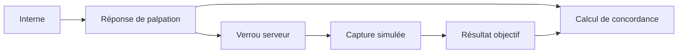

# LT-13 · Banc de formation et concordance

## Résumé
Le banc propose un parcours d’entraînement aveugle : l’interne enregistre sa palpation avant que les résultats objectifs soient révélés. Une fonction calcule une concordance pondérée entre sensation, intensité et notes. Les profils et références d’intensité sont explicitement provisoires et à calibrer; aucune interprétation clinique n’en découle (`apps/api-nestjs/src/modules/bench/bench.constants.ts`).

## 1. Contexte et problématique
L’entraînement vise à comparer une perception de thrill à une mesure simulée. Le serveur doit empêcher l’accès aux données objectives avant la réponse de palpation (AGENTS.md, §4 règle 9; `apps/api-nestjs/src/modules/bench/bench.service.ts`).

## 2. Objectifs
- Enregistrer la perception et appliquer la règle de révélation côté serveur (AGENTS.md, §4 règle 9).
- Calculer un score de concordance à partir de catégories, d’intensité et de notes (`apps/api-nestjs/src/modules/bench/bench.concordance.ts`).
- Marquer comme provisoires les paramètres de banc en attendant une calibration réelle (`apps/api-nestjs/src/modules/bench/bench.constants.ts`).

## 3. Démarche et méthode
Les tests de logique examinent le calcul de concordance; les tests d’intégration vérifient les transitions de banc et les refus d’accès (`apps/api-nestjs/src/modules/bench/bench.concordance.spec.ts`; `apps/api-nestjs/src/modules/bench/bench.e2e-spec.ts`). L’API utilise une mise à jour conditionnelle pour éviter d’écraser une palpation ou une capture déjà prise (journal du hub, T-s12).

## 4. Conception

Le score se décompose en sensation, intensité et notes (`apps/api-nestjs/src/modules/bench/bench.concordance.ts`).

## 5. Réalisation
L’échelle de sensation et les profils attendus sont déclarés dans les constantes du module. Les pondérations sont 60 %, 25 % et 15 % respectivement, des valeurs de démonstration présentes dans le code et non des paramètres validés cliniquement (`apps/api-nestjs/src/modules/bench/bench.constants.ts`). La capture du banc est désactivée si l’identifiant d’appareil configuré est absent ou invalide (journal du hub, T-s17).

## 6. Vérification et résultats
| Vérification | Résultat | Source |
|---|---|---|
| Tests unitaires de concordance | Sept tests ciblés passent dans un run | journal du hub, T-s12 |
| Tests de protection concurrente | Tests de concurrence passés dans la suite complète de l’API (117 passés le 2026-11-08) ; l’avertissement initial venait du bac à sable de l’agent | `pnpm --filter @dsfav/api test` |
| Interface du banc | Suite web rapportée à 98 tests passés lors de runs finaux | journal du hub, T-s17 et T-s18 |

## 7. Décisions et justifications
Les profils attendus et seuils d’intensité sont explicitement nommés `PLACEHOLDER`; les remplacer nécessite des mesures de banc et une décision documentée (code `bench.constants.ts`; AGENTS.md, §4 règle 6). Le résultat est une aide pédagogique et ne correspond pas à une conclusion médicale (AGENTS.md, §4 règle 10).

## 8. Limites et points ouverts
Les profils et références restent des valeurs de remplacement à calibrer. La concordance vérifie la cohérence avec les attentes programmées, pas la validité des attentes ni la compétence clinique (code `bench.constants.ts`; `.ultraplan/sections/section-09-bench-study-kit.md`). L’intégration serveur concurrente n’a pas été entièrement prouvée dans le shell du builder en raison de la résolution Prisma (journal du hub, T-s12).

## 9. Ce qu'il faut retenir
- La réponse de palpation précède la révélation objective.
- Le score décrit un écart aux profils configurés.
- Les profils configurés sont provisoires.
- Le banc ne produit aucune preuve médicale.

## 10. Questions possibles du jury
- **Pourquoi cacher le résultat objectif au départ ?** Pour préserver un exercice de palpation indépendant (AGENTS.md, §4 règle 9).
- **Que signifie le score ?** Une concordance calculée entre trois composantes pondérées (`bench.concordance.ts`; `bench.constants.ts`).
- **Les profils sont-ils validés ?** Non, ils sont explicitement provisoires et doivent être calibrés au banc (`bench.constants.ts`).

## Références
`apps/api-nestjs/src/modules/bench/` · `apps/web-nextjs/src/features/bench/` · `.agent-hub/events.jsonl` (T-s12, T-s17, T-s18) · `.ultraplan/sections/section-09-bench-study-kit.md` · `AGENTS.md`, §4
