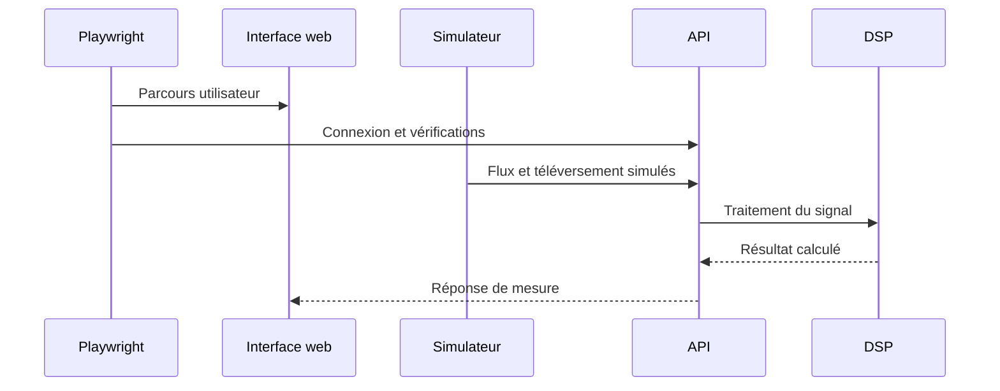

# LT-14 · Intégration et démonstration de bout en bout

## Résumé
La suite Playwright décrit huit étapes de démonstration et un scénario de banc. Le compte rendu d’intégration fait état de dix tests e2e réussis sur la pile active (journal du hub, T-s14). L’étape de coupure réseau vérifie l’arrêt avant téléversement brut; elle ne prouve pas la mise en file et la reprise attendues d’un scénario de perte de session (`e2e/tests/demo.spec.ts`; `docs/BACKLOG.md`).

## 1. Contexte et problématique
Une démonstration reproductible relie simulateur, API, DSP et interface. Le plan prévoit les scénarios de capture normale, pression, mouvement, évolution, historique, banc et perte de connexion (`pre-dev/10-build-plan.md`, §8; `.ultraplan/sections/section-14-demo-e2e.md`).

## 2. Objectifs
- Vérifier les huit étapes taguées et le parcours de banc (`e2e/tests/demo.spec.ts`; `e2e/tests/bench.spec.ts`).
- Utiliser le simulateur avec la même interface de protocole que le dispositif (`scripts/simulator/src/dsfav_sim/`).
- Décrire clairement ce que la démonstration prouve et ce qu’elle ne prouve pas (AGENTS.md, §4 règle 10).

## 3. Démarche et méthode
Playwright pilote l’interface et appelle les routes API; le simulateur produit les événements et envoie les captures. Le test d’intégration de démonstration rapporte dix réussites; un run antérieur avait neuf réussites et un test ignoré faute de variable `WEB_URL` (journal du hub, T-s14).

## 4. Conception

Le scénario de test exécute le simulateur depuis le projet e2e et vérifie la réponse du téléversement (`e2e/tests/demo.spec.ts`).

## 5. Réalisation
Les étapes vérifient accès aux comptes de démonstration, capture normale, refus de pression basse puis récupération, mouvement léger, rejet de mouvement fort, répétition simulée, historique et avertissement, puis coupure de connexion. Ces intitulés sont définis dans `e2e/tests/demo.spec.ts`. Le scénario de banc se trouve dans `e2e/tests/bench.spec.ts`.

## 6. Vérification et résultats
| Vérification | Résultat | Source |
|---|---|---|
| Suite e2e de démonstration | Dix tests passés dans le run rapporté par l’orchestrateur | journal du hub, T-s14 |
| Run initial du builder | Neuf tests passés, un ignoré car `WEB_URL` n’était pas défini | journal du hub, T-s14 |
| Étape de coupure réseau | Le simulateur confirme la coupure et l’absence de téléversement brut | `e2e/tests/demo.spec.ts`, test `[NO-LOSS]` |
| Mise en file et reprise après perte | Non prouvées par cette étape; limite inscrite au backlog | `docs/BACKLOG.md`, entrée « Offline queue… »; journal du hub, T-s14 |

## 7. Décisions et justifications
La démonstration utilise les services de développement et des données synthétiques, sans faire de déclaration clinique (AGENTS.md, §4 règle 10). Les scripts d’authentification utilisent les comptes seedés du test, et les secrets de périphérique sont fournis par l’environnement du processus (e2e/tests/demo.spec.ts).

## 8. Limites et points ouverts
La preuve du scénario « drop » s’arrête avant l’envoi du fichier brut; elle ne démontre pas la reprise idempotente d’un élément mis en file (`e2e/tests/demo.spec.ts`; `docs/BACKLOG.md`). Le scénario d’historique dépend de la session web et des comptes seedés (e2e/tests/demo.spec.ts). La simulation ne valide ni capteur physique ni diagnostic.

## 9. Ce qu'il faut retenir
- La suite relie l’interface, l’API, le simulateur et le DSP.
- Les scénarios vérifient le comportement logiciel observable.
- La reprise après coupure reste une limite de la preuve actuelle.
- Aucun test synthétique ne prouve une efficacité clinique.

## 10. Questions possibles du jury
- **Que prouve le test e2e ?** Que le parcours logiciel fonctionne sur la pile et les données testées (journal du hub, T-s14).
- **La coupure réseau prouve-t-elle qu’aucune séance n’est perdue ?** Non; ce test vérifie l’arrêt avant téléversement, pas la reprise depuis une file (`e2e/tests/demo.spec.ts`; `docs/BACKLOG.md`).
- **Le résultat démontre-t-il une capacité diagnostique ?** Non, il n’y a aucune conclusion clinique à partir de données synthétiques (AGENTS.md, §4 règle 10).

## Références
`e2e/tests/demo.spec.ts` · `e2e/tests/bench.spec.ts` · `scripts/simulator/src/dsfav_sim/` · `.agent-hub/events.jsonl` (T-s14) · `docs/BACKLOG.md` · `pre-dev/10-build-plan.md`
