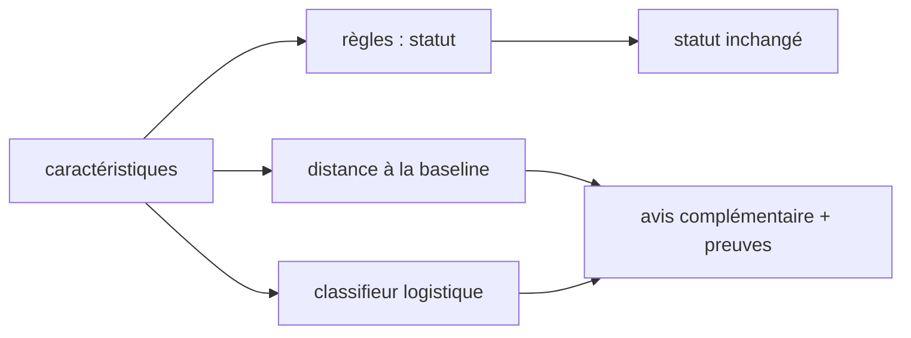

# LT-17 · Couche d'IA explicable

## Résumé
Le système n'utilisait aucun apprentissage : un statut vient de règles fixes comparant la séance à la baseline du patient. Une couche d'IA **explicable** a été ajoutée à côté, comme second avis optionnel. Les règles continuent de décider du statut ; l'IA ne déclenche jamais d'alerte, n'affiche rien pendant la constitution de la baseline et montre toujours ses preuves (sources en §6).

## 1. Contexte et problématique
Une IA « boîte noire » est incompatible avec une aide à la décision médicale, et sans données réelles étiquetées on ne peut rien entraîner de valide. Un modèle appris sur le simulateur apprendrait le simulateur.

## 2. Objectifs
- Un avis complémentaire transparent : mesure de la distance à la baseline du patient et classifieur simple.
- Aucune conséquence sur le statut des règles, aucune alerte propre.
- Un étiquetage honnête : « Données synthétiques, non cliniques » tant que l'entraînement est synthétique.

## 3. Démarche et méthode
Décision D-013 du plan (modèles transparents uniquement, `numpy` et `scipy` déjà installés, aucune dépendance nouvelle). Conception documentée dans `docs/ai/design.md`. Réalisation en deux passes : moteur côté DSP, puis contrat, API et carte d'interface.

## 4. Conception

Le résultat porte : les caractéristiques mesurées, les valeurs de référence, les principaux contributeurs, la version du modèle et l'étiquette des données.

## 5. Réalisation
- Modules `apps/dsp-python/src/dsfav_dsp/ai/` : caractéristiques robustes, normalité, classifieur entraînable de façon déterministe, fichier de modèle versionné avec ses métriques.
- Le pipeline renvoie un bloc `aiOpinion` optionnel, seulement si un fichier de modèle existe et si la baseline est verrouillée.
- Contrat : champ optionnel `aiOpinion`. API : stockage et restitution inchangés.
- Interface : carte « Avis complémentaire » (preuves d'abord, puis niveau), masquée si absente ou pendant `BASELINE_BUILDING`, avec le même avertissement unique que le reste de l'écran.

## 6. Vérification et résultats
| Vérification | Résultat | Source |
|---|---|---|
| Tests du moteur | 38 passent (25 avant la couche) | `uv run pytest`, 2026-11-09 |
| Statut des règles identique avec et sans IA | test dédié | `apps/dsp-python/tests/ai` |
| Aucune sortie IA pendant la constitution de la baseline | test dédié | idem |
| Fonctionnement sans fichier de modèle | test dédié | idem |
| Carte web : cas affichée, masquée, un seul avertissement | 8 tests | `result-card-ai.test.tsx`, `patient-detail-ai.test.tsx` |

## 7. Décisions et justifications
- Des modèles simples et lisibles plutôt qu'une boîte noire, car une explication chiffrée est exigée par les règles du projet.
- Aucun « score IA » sans la mesure à côté (règle 8 de `AGENTS.md`).
- Le fichier de modèle est optionnel : l'application fonctionne identiquement sans lui.

## 8. Limites et points ouverts
L'entraînement est **synthétique** : la couche démontre la méthode, pas une valeur clinique (règle 10). Le chemin vers les données réelles (export des caractéristiques étiquetées, réentraînement, validation, seuil d’acceptation à confirmer avec le superviseur) est documenté dans `docs/ai/real-data.md` et testé sur les données synthétiques de l’étude virtuelle. Le point d'accès d'historique du patient ne renvoie pas encore l'avis IA par séance.

## 9. Ce qu'il faut retenir
- L'IA ajoute un second avis lisible ; elle ne remplace pas les règles.
- Sans données réelles étiquetées, on ne prétend pas à une performance clinique.
- Un modèle absent ne doit rien casser.

## 10. Questions possibles du jury
- **Pourquoi pas un réseau de neurones ?** Il faudrait des milliers de séances réelles étiquetées, et son explication serait faible.
- **L'IA peut-elle déclencher une alerte ?** Non, jamais : seules les règles configurées produisent un statut.
- **Comment passer aux données réelles ?** Étude sur banc, export étiqueté, réentraînement, validation sur un jeu séparé, puis décision du superviseur.

## Références
`docs/ai/design.md` · `docs/ai/real-data.md` · `apps/dsp-python/src/dsfav_dsp/ai/` · `docs/DECISIONS.md` · `AGENTS.md` §4 règles 8 et 10
