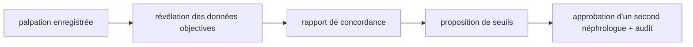

# LT-19 · Kit d'étude sur banc et étude virtuelle

## Résumé
Tout ce qu'il faut pour réaliser l'étude sur banc le jour où un appareil existe est prêt : protocole écrit, fiches de données, import de résultats, rapport de concordance et outil de proposition de seuils soumis à approbation. Une étude **virtuelle** sur le simulateur, étiquetée synthétique, démontre la méthode de bout en bout. Elle ne prouve rien de clinique (sources en §6).

## 1. Contexte et problématique
Les seuils cliniques sont des valeurs par défaut « à calibrer au banc ». Sans appareil, on ne peut pas mesurer : on prépare donc la méthode, les formulaires et les outils d'analyse pour que l'étude réelle soit rapide et sans improvisation.

## 2. Objectifs
- Un protocole sur fantôme (aucun humain), valeurs de pince de 0, 30, 50 et 75 %.
- Un import de données qui refuse toute colonne de données personnelles.
- Un rapport de concordance entre la palpation et la mesure objective.
- Une proposition de seuils qui ne modifie jamais la configuration sans approbation du néphrologue et sans événement d'audit.

## 3. Démarche et méthode
Tâche T-w09 pour le kit. La règle du banc est imposée par le serveur : aucune donnée objective avant l'enregistrement de la réponse de palpation (règle 9 de `AGENTS.md`).

## 4. Conception

## 5. Réalisation
- Documents : `docs/bench-study/protocol.md`, `data-sheet.md`, `import-format.md`.
- API : import de résultats par fichier CSV, rapport de concordance, propositions de seuils que seul un néphrologue différent de l'auteur peut approuver dans une transaction auditée.
- Étude virtuelle : exécution automatique de 8 séances (2 par niveau de pince : 0, 30, 50 et 75 %) sur fantôme virtuel, via l’API réelle, avec un rapport en français (`docs/bench-study/virtual-study-report.md`) et un fichier de caractéristiques étiquetées (`apps/dsp-python/data/virtual-bench-features.csv`) pour le réentraînement de la couche d’IA. Les réponses de palpation sont scriptées : la concordance affichée (environ 92 %) est obtenue par construction et ne mesure aucune perception humaine.

## 6. Vérification et résultats
| Vérification | Résultat | Source |
|---|---|---|
| Tests du module banc et de la configuration | 20 passent | `pnpm --filter @dsfav/api test`, 2026-11-08 |
| Rejet d'un fichier avec colonne de données personnelles | testé | module banc, test d'import |
| Étude virtuelle | 8 séances, concordance moyenne 92,19 % (palpation scriptée, donc par construction) | `docs/bench-study/virtual-study-report.md` |
| Chemin de réentraînement de l’IA | 43 tests du moteur passent, dont 4 de réentraînement (rejet d’une colonne de données personnelles compris) | `uv run pytest`, 2026-11-10 |

## 7. Décisions et justifications
- Étude sur fantôme uniquement : aucun comité d'éthique n'est nécessaire pour cette partie ; toute donnée humaine ultérieure en exigerait un.
- Les jeux de données synthétiques portent l'étiquette « Données synthétiques, non cliniques ».

## 8. Limites et points ouverts
Aucune donnée réelle. Les statistiques de concordance sont élémentaires et ne remplacent pas un plan d'analyse validé par le superviseur. Le fantôme et la pompe restent à réunir.

## 9. Ce qu'il faut retenir
- Préparer la méthode avant le matériel réduit le risque de l'étude réelle.
- Une proposition de seuils ne s'applique jamais sans approbation et trace d'audit.
- Un rapport sur données synthétiques démontre une méthode, jamais une performance.

## 10. Questions possibles du jury
- **Pourquoi quatre niveaux de pince ?** Ils correspondent à la sévérité simulée de la sténose du fantôme (0, 30, 50, 75 %).
- **Qui valide les nouveaux seuils ?** Un néphrologue différent de l'auteur de la proposition, avec un événement d'audit.
- **L'étude virtuelle prouve-t-elle quelque chose ?** Elle prouve que la chaîne d'analyse fonctionne ; la validité clinique exige l'étude réelle.

## Références
`docs/bench-study/` · `apps/api-nestjs/src/modules/bench/` · `apps/api-nestjs/src/modules/config/` · `AGENTS.md` §4 règles 9 et 10
