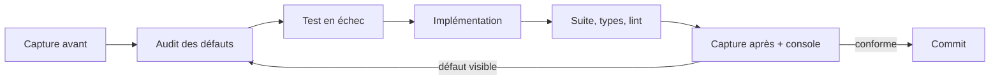

# LT-21 · Refonte des écrans avec les compétences de conception

## Résumé
Après la livraison de LT-15, le propriétaire a relevé page par page des défauts d'usage : une page patient de 2000 px pour 2 séances, une page d'acquisition dont le bouton de départ était hors écran, des journaux illisibles (codes bruts, dates ISO), un profil utilisateur accessible seulement en bas de page. Neuf écrans ont été repris, un composant interactif a été créé (schéma de la fistule) et une règle de méthode a été ajoutée au dépôt : tout travail d'interface passe par des compétences de conception (`unslop`, `impeccable`, `hallmark`) et se prouve par une capture d'écran réelle. Résultat chiffré principal : la page patient passe de 2000 à 1186 px de haut (mesure Playwright, §6) et la suite web de 149 à 186 tests réussis (§6).

## 1. Contexte et problématique
LT-15 avait corrigé les graphiques de l'acquisition et du suivi patient. Il restait les autres écrans, construits au fil des lots à partir de composants voisins, sans passe de conception : tableau de bord, notes, historiques, paramètres, journal d'audit, appareils. Les cas d'usage concernés sont UC1 (acquisition), UC2 (pression), UC8 et UC9 (suivi et écart), UC11 (banc), UC13 (audit) du cahier des charges (`pre-dev/10-build-plan.md` §4). Une question du propriétaire a aussi mis en évidence un manque de méthode : les compétences de conception du projet n'avaient pas été chargées avant de construire ces écrans.

## 2. Objectifs
| Objectif | Critère d'acceptation |
|---|---|
| Aucune donnée machine à l'écran (dates ISO, codes d'énumération, identifiants longs) | Tests `[UC13]`, `[UC8]` sur les libellés et les dates; capture réelle |
| Page patient courte et lisible | Hauteur de page mesurée au navigateur à 1440 x 900 |
| Action principale toujours accessible | Bouton Démarrer visible sans défilement à 900 px de haut |
| Profil utilisateur toujours visible et cliquable, y compris barre réduite | Test `[AUTHZ-MATRIX]` et capture aux deux largeurs |
| Règle de méthode durable | Règle inscrite dans `AGENTS.md`, `CLAUDE.md`, une compétence de projet et le générateur de briefs |

## 3. Démarche et méthode
Pour chaque écran : (1) capture « avant » dans un navigateur piloté (Playwright), (2) audit des défauts, (3) test écrit avant le code et constaté en échec, (4) implémentation, (5) suite complète, vérification de types et lint, (6) capture « après », regard sur l'image, (7) commit. L'étape 6 n'est pas remplaçable par les tests : plusieurs défauts de ce lot n'ont été vus que sur la capture (§5, tableau des défauts).

À partir du commit `6eb420d`, les travaux d'interface suivent les compétences `unslop` (audit des signes d'interface générique, passes ordonnées), `impeccable` (registre « produit », lois de conception) et `hallmark` (audit et autocritique). La compétence `design-taste-frontend` est réservée aux pages de marque : son en-tête exclut les tableaux de bord et l'interface produit.

## 4. Conception
Trois choix structurants.

**Un schéma interactif plutôt qu'une image.** La page patient affichait deux fichiers SVG statiques. Le schéma est maintenant dessiné en SVG intégré (`apps/web-nextjs/src/features/patients/ui/fistula-map.tsx`). Quatre zones (anastomose, veine de drainage, site du capteur, artère d'apport) commandent un même panneau de détail. Les boutons radio sous le schéma sont le contrôle accessible (clavier, lecteur d'écran); les zones du dessin sont un raccourci à la souris vers le même choix. L'artère est dessinée pour le repère et le panneau indique « Non mesurée » : le capteur ne mesure que le thrill veineux.

**Des onglets pour réduire la longueur.** Tendance, spectrogramme, séances et notes sont regroupés (`patient-detail.tsx`). Les panneaux restent montés et masqués (`forceMount`) pour que les graphiques gardent leur taille. Les onglets sont posés sur la page et non dans une carte, pour éviter des cartes imbriquées.

**Un composant de profil unique.** `user-menu.tsx` remplace le texte « Déconnexion » masqué sous 1024 px : un seul bouton à toutes les largeurs, qui ouvre un menu (rôle, identifiant pseudonyme, déconnexion). Le menu se ferme avec Échap ou un clic extérieur et rend le focus au bouton.

## 5. Réalisation
| Écran | Changement principal | Commit |
|---|---|---|
| Tableau de bord | Cinq tuiles de comptage par statut qui filtrent la file; les séances de banc (sans patient) ne figurent plus dans la file | `b564365` |
| Acquisition | Liste réelle des patients et appareil enregistré lus par l'API, état hors ligne de l'appareil, case à cocher de protocole honnête, pression bloquée dite une seule fois | `455d2e5`, `8aaabfd` |
| Acquisition (finitions) | Barre départ/arrêt collée en bas, minuteur et barre de progression sur une ligne (`role="progressbar"`), carte de protocole sur surface neutre | `b1cabdf` |
| Courbe du signal | Une seule trace, couleurs lues dans le thème, grille alignée | `f418ca1` |
| Notes | Espace à deux panneaux : liste des patients, saisie de note, historique filtrable | `f418ca1`, `9b01c16` |
| Journal d'audit, références, banc, paramètres, appareils | Événements en français avec catégories, détails lisibles, cartes d'historique, seuils regroupés par thème | `19697e7` |
| Barre latérale | Fixée à la hauteur de la fenêtre, profil cliquable | `e9e68c2` |
| Page patient | Schéma interactif, onglets | `5e75ac4` |

Composants créés : `fistula-map.tsx`, `user-menu.tsx`, `components/shared/patient-nav.tsx`, `notes-composer.tsx`, `notes-timeline.tsx`, `admin/audit-labels.ts`, `libs/format/datetime.ts`, `capture/data/capture-sources.ts`.

**Défauts trouvés par la vérification dans le navigateur et non par les tests**

| Défaut | Cause | Correction |
|---|---|---|
| Liste de patients transparente | Deux classes CSS collées par erreur (`w-80bg-surface`) lors d'une modification | `f418ca1` |
| Courbe dédoublée, trait noir | Deux moteurs dessinaient les mêmes traces; un canvas ne résout pas les variables CSS | `f418ca1` |
| Erreur console sur 4 routes | Lecture de données hors d'une frontière `Suspense` | `f418ca1`, `9b01c16`, `19697e7` |
| Barre collée sans effet | `overflow-x-hidden` sur `<main>` crée un conteneur de défilement | `b1cabdf` (`overflow-x-clip`) |
| Avertissement de clé React dupliquée | Deux composants frères avec la même clé | `9b01c16` |

## 6. Vérification et résultats
| Contrôle | Résultat | Source |
|---|---|---|
| Suite web | 186 tests réussis, 32 fichiers (149 tests, 25 fichiers au début du lot) | `pnpm exec vitest run` dans `apps/web-nextjs`, sortie « Test Files 32 passed, Tests 186 passed » |
| Types et lint | Aucune erreur | `pnpm exec tsc --noEmit`, `pnpm exec eslint` |
| Hauteur de la page patient | 2000 px avant, 1186 px après (1440 x 900) | `document.documentElement.scrollHeight`; `docs/visual/screens/before-patient-4471.png`, `after-patient-4471.png` |
| Bouton Démarrer | Environ 1000 px avant (hors écran), visible dans 900 px après | `before-capture2.png`, `after-capture2.png` |
| Console navigateur | 0 erreur sur l'acquisition en mode démonstration | `after-capture2-demo.png` |
| Profil | Barre à 0 px du haut et bouton à 684 px sur 700 après défilement de 268 px | mesure `getBoundingClientRect`, `sidebar-wide-menu.png`, `sidebar-collapsed-menu.png` |

La suite API (145 tests) n'a pas été relancée pour ce lot, hormis le test ajouté pour la file (`apps/api-nestjs/test/measurements.e2e-spec.ts`, `[UC8] [UC10]`) : non mesuré à nouveau sur l'ensemble.

## 7. Décisions et justifications
D-014 (`docs/DECISIONS.md`) : les compétences de conception modernes sont obligatoires pour tout travail d'interface, via `.claude/skills/dsfav-design/SKILL.md`. Le générateur de briefs (`tools/briefs/gen.mjs`) ajoute `dsfav-design`, `unslop`, `impeccable` et `hallmark` aux tâches web, et le noyau les copie dans le cache des travailleurs (`.agent-hub/tools/skills.mjs`, racines `~/.claude/skills`). Le rapport de fin de tâche cite une règle appliquée par compétence.

## 8. Limites et points ouverts
- **Données de la page Appareils.** Les lignes sont réelles (table `Device`, lues par l'API à chaque chargement, `cache: no-store`) mais leurs valeurs viennent du jeu de départ : batterie 95, 78, 54 et 12 %, gain 1,039 pour UNIT-04 (`apps/api-nestjs/prisma/seed.ts:78-81`). La batterie et la date de synchronisation ne changent que lorsqu'un appareil appelle la synchronisation (`devices.service.ts:212-217`). Les 8 éléments en échec de UNIT-01 sont des restes de tests négatifs : 6 `PATIENT_UNKNOWN`, 1 `INVALID_HEADER`, 1 `SYNC_ITEM_FAILED` (requête SQL sur `SyncQueueItem`, 2026-11-10). La page n'est pas en temps réel : aucun rafraîchissement automatique.
- **Compétences.** Un audit `hallmark` n'a pas été exécuté; `impeccable document` n'a pas produit de `DESIGN.md`.
- **Tuiles de métriques** de la page patient : les mini-courbes sont plates avec 2 séances et n'apportent pas d'information.
- **Acquisition** : trois cartes de même taille en tête, pression affichée dans la carte et sous la courbe; à 900 px de haut la barre collée masque le bas du graphique jusqu'au défilement.
- **Aucune conclusion clinique** : les statuts affichés (par exemple « Évolution inhabituelle ») proviennent de signaux simulés et ne prouvent que le calcul (AGENTS.md §4 règle 10).
- Les captures d'écran ne remplacent pas un test d'utilisabilité avec des infirmiers ou des néphrologues : non mesuré.

## 9. Ce qu'il faut retenir
1. Un test unitaire vert ne prouve pas qu'un écran est correct : cinq défauts de ce lot n'ont été vus que dans un navigateur.
2. Une règle de méthode n'existe que si elle est écrite là où l'agent la lit (consignes du dépôt, compétence, générateur de briefs).
3. Une donnée « réelle » peut venir d'une base sans être vivante : il faut distinguer lecture réelle, valeur de départ et temps réel.
4. Un schéma interactif doit dire ce qu'il ne mesure pas (l'artère).
5. Réduire la longueur d'une page passe par le regroupement et non par la suppression d'information.

## 10. Questions possibles du jury
1. **Les valeurs de la page Appareils sont-elles temps réel ?** Non. Elles sont lues en base à chaque chargement; batterie et synchronisation ne bougent que par un appel de synchronisation (`devices.service.ts:212-217`).
2. **Pourquoi des captures d'écran en plus des tests ?** Cinq défauts visibles n'avaient aucun test en échec (§5, tableau).
3. **Que représente le schéma interactif ?** Quatre zones; trois portent une valeur réelle de la dernière séance valide, l'artère est indiquée « non mesurée » (`fistula-map.tsx`).
4. **Pourquoi `design-taste-frontend` n'est-il pas appliqué ?** Son en-tête l'exclut pour les tableaux de bord et l'interface produit (fichier de la compétence).
5. **Le statut « Évolution inhabituelle » a-t-il une valeur clinique ici ?** Non, les signaux sont simulés (AGENTS.md §4 règle 10; `docs/academic/ce-qui-est-prouve.md`).

## Références
- Commits `b564365` à `b1cabdf` (`git log --oneline`).
- `docs/DECISIONS.md` D-014; `AGENTS.md` §5 règle 9; `.claude/skills/dsfav-design/SKILL.md`.
- `docs/visual/screens/` (captures avant et après), `docs/UI-AUDIT.md`, `docs/BACKLOG.md`.
- LT-15 (interfaces et graphiques médicaux), LT-16 (droits et sécurité), LT-20 (intégration et limites).
